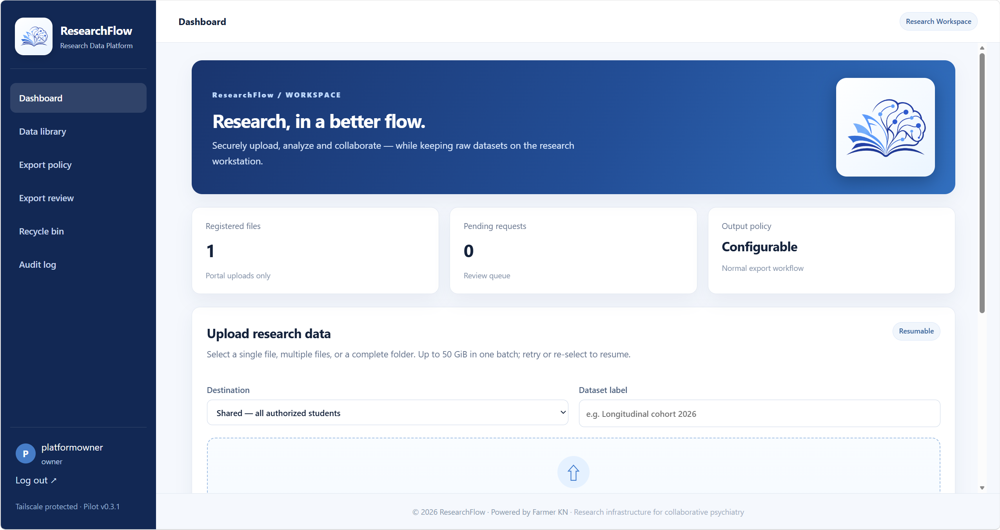
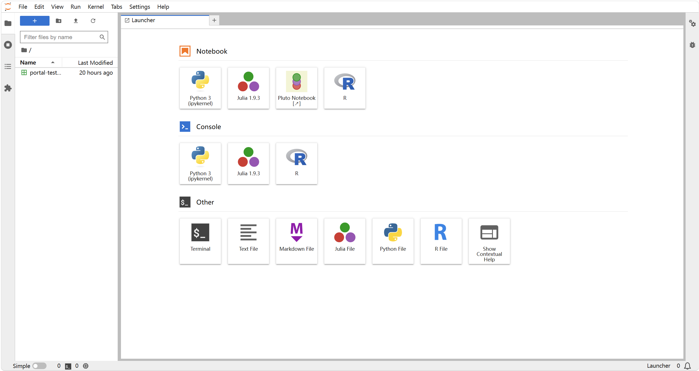

# Jupyter Research Platform

[English](README.md) | [简体中文](README.zh-CN.md)

A self-hosted, multi-user JupyterLab environment for collaborative research data analysis.

This project presents a containerized workspace platform designed to support browser-based computational research across research teams.

> **Repository scope:** This is a public-facing project overview, not the production deployment repository. It intentionally excludes deployment secrets, private infrastructure details, real research data, and user files.

## Overview

- **Browser-based analysis** — interactive research workflows through JupyterLab.
- **Separated workspaces** — Docker containers help isolate individual working environments.
- **Restricted access** — designed for authorized collaborators rather than public, unauthenticated notebook hosting.
- **Shared research infrastructure** — a common entry point for computational work across a research team.
- **Maintainability and data protection** — designed with operational maintenance and responsible handling of research data in mind.

## Platform Preview

### ResearchFlow Portal

The ResearchFlow portal provides a unified entry point for research data workflows, including data upload, export review, file management, and audit-related functions.

### JupyterLab Workspace

The computational workspace provides access to interactive notebooks and supported computing environments. Available kernels depend on the deployment configuration.

## Technology

- **JupyterLab** — browser-based notebooks and interactive analysis.
- **Docker** — containerized workspace deployment.
- **Tailscale** — private-network connectivity for authorized access.
- **Python and other notebook kernels** — availability depends on the deployed environment.

The exact services, kernels, and features available to users depend on the current deployment. This showcase repository does not itself deploy or operate the platform.

## Security and Privacy

This platform is intended for authorized research collaborators. Public materials will not include:

- Passwords, access tokens, API keys, or Jupyter credentials.
- Publicly usable server addresses or internal network details.
- User-specific files, private logs, or identifiable account information.
- Unreleased research data or materials that have not been approved for public release.

Screenshots and examples will be reviewed and sanitized before publication.

## Maintainer

Developed and maintained by [FarmerKN](https://github.com/FarmerKN).

---

*This repository is a project showcase. It does not provide public access to the live platform and does not imply that the production deployment is open source.*
